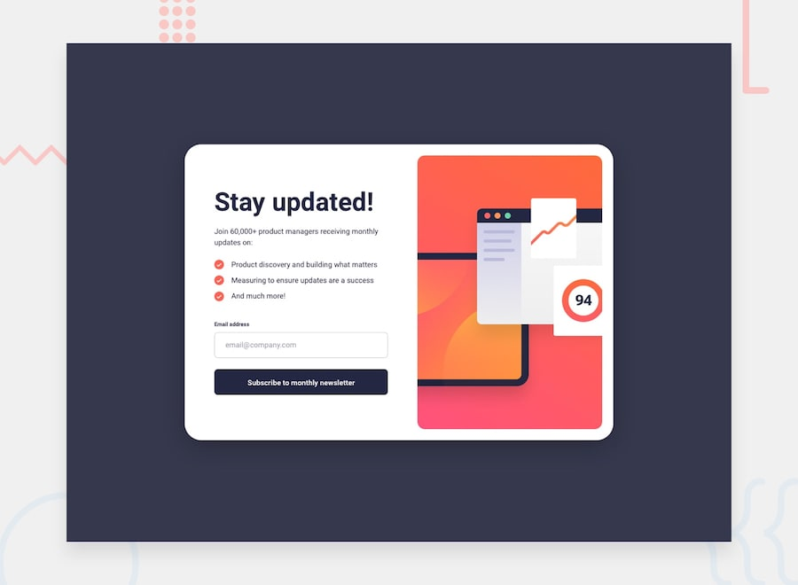

# Frontend Mentor - Newsletter sign-up form with success message solution

## Table of contents
- Overview
- My process
- Author

## Overview

### The challenge
Users should be able to:
- Add their email and submit the form
- See a success message with their email after successfully submitting the form
- See form validation messages if:
  - The field is left empty
  - The email address is not formatted correctly
- See the optimal layout for the interface depending on their device's screen size
- See hover and focus states for all interactive elements on the page

### Screenshot

### Links
- Solution URL: https://github.com/MohamedWalid45/newsletter-sign-up-form-with-success-message-main
- Live Site URL: https://mohamedwalid45.github.io/newsletter-sign-up-form-with-success-message-main/

## My process

### Built with
- Semantic HTML5
- CSS3 / Bootstrap
- Flexbox
- Vanilla JavaScript
- Mobile-first workflow

### What I learned

### Continued development

### Useful resources

## Author
- GitHub - [@MohamedWalid45](https://github.com/MohamedWalid45)
- Frontend Mentor - [@MohamedWalid45](https://www.frontendmentor.io/profile/MohamedWalid45)